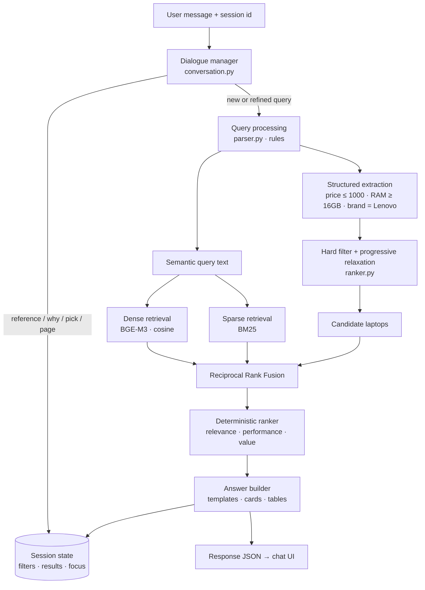

# 💻 Laptop Finder: Conversational RAG Without an LLM

A **retrieval-augmented, knowledge-based question-answering system** over a dataset of 1,275 laptops. You can chat
with it in plain English: *"gaming laptop under €1000 with 16GB RAM"* → *"show cheaper ones"* →
*"is the second one good for video editing?"* → *"compare the first two"*.

**There is no LLM and no external API.** Every answer is computed from the data by a deterministic pipeline:

> rule-based query understanding → hard filtering → hybrid retrieval (**BGE-M3** dense + **BM25**) →
> deterministic ranking → template-based answers, with a rule-based dialogue manager for multi-turn conversation.

The same question in the same context always gives the same answer. Every number shown comes from the dataset,
so nothing is hallucinated, and every answer can explain itself ("How this answer was computed").

---

## Table of contents

- [Features](#-features)
- [Quick start (local)](#-quick-start-local)
- [Run with Docker](#-run-with-docker)
- [Example conversation](#-example-conversation)
- [Architecture](#-architecture)
- [How it works, stage by stage](#-how-it-works-stage-by-stage)
- [Conversation memory](#-conversation-memory-multi-turn-without-an-llm)
- [Project structure](#-project-structure)
- [API](#-api)
- [Configuration](#-configuration)
- [Design decisions & FAQ (cost, deployment, performance)](#-design-decisions--faq-cost-deployment-performance)
- [Limitations](#-limitations)
- [About me](#-about-me)

---

## ✨ Features

**Understanding questions (rules, no LLM)**
- Price: `under 1k`, `between 500 and 900 euros`, `around €600`, `max 800`, `cheaper than 1200`
- Memory and storage: `16GB RAM`, `at least 8gb`, `512gb ssd`, `1TB HDD`, `8gb ram or less`
- Screen and weight: `15.6 inch`, `17"`, `large screen`, `under 1.5 kg`, `lightweight`
- Brands with negation: `Lenovo or HP`, `not Apple`, `except Dell and HP`
- Product lines and models: `ThinkPad`, `XPS 13`, `MacBook Air`, `Legion Y520`
- CPU: `i7`, `i5 or better`, `Ryzen`, `Celeron`, `2.5GHz`
- GPU: `Nvidia`, `GTX 1060`, `dedicated GPU`, `integrated graphics`
- OS and display: `Windows`, `Linux`, `no OS`, `touchscreen`, `IPS`, `Full HD`, `4K`
- Use cases: gaming, students, programming, video editing, machine learning, office, travel, workstation/CAD
- Sorting: `cheapest`, `lightest`, `most powerful`, `best value`, `most RAM`, `biggest screen`
- Result count: `top 3`, `show me 10 laptops`

**Question types**
- **Search / recommend**: ranked laptop cards
- **Count**: `how many HP laptops have 16GB RAM?` (with a breakdown table)
- **Aggregate**: `average price of gaming laptops`, `price range of Apple laptops`
- **List**: `which brands make workstations?`, `what operating systems are available?`
- **Compare**: `Dell vs HP` (group statistics) or `XPS 13 vs MacBook Air` (spec-by-spec)
- **Overview**: `dataset overview`

**Conversation (multi-turn)**
- Follow-ups refine the previous search: `what about HP?`, `under 800`, `also Asus`, `only with SSD`
- Relative refinements: `cheaper ones`, `lighter`, `more RAM`, `more powerful ones`
- References: `the second one`, `#3`, `it`, `the Dell one`
- Questions about a laptop: `is it good for gaming?`, `how heavy is it?`, `does it have an SSD?`
- `which one is the lightest?`, `compare the first two`, `similar but cheaper`, `show more`, `why this one?`
- Drop filters: `any brand`, `remove the price limit`, the × on a filter chip, or `start over`

**Honest by design**
- If no laptop matches every filter, the least important filter is relaxed and the answer says which one.
- Questions about data the dataset doesn't contain (battery life, ports, webcam, release year…) are answered
  with *"the dataset doesn't contain that"* instead of a guess.
- Off-topic questions (weather, recipes, jokes) are politely declined.

**Interface**
- Chat UI that works on phones, tablets and desktops, with dark/light mode
- Laptop cards, statistics tables and clickable follow-up suggestions
- A **"Remembering:"** bar showing the active filters, each removable with ×
- A **"How this answer was computed"** panel showing the intent, filters, sort, retrieval mode and timing
- Keyword search works immediately at startup, and hybrid search switches on once the embeddings are ready

---

## 🚀 Quick start (local)

**Requirements:** Python 3.11+, about 4–5 GB of free RAM for BGE-M3 on CPU (or about 0.5 GB with `ENABLE_DENSE=false`),
and about 3 GB of disk for the model.

### Windows (PowerShell)

```powershell
git clone <your-repo-url>
cd "Laptop RaG Based"

python -m venv venv
venv\Scripts\activate
pip install -r requirements.txt

python app/main.py
```

### macOS / Linux

```bash
git clone <your-repo-url>
cd "Laptop RaG Based"

python3 -m venv venv
source venv/bin/activate
pip install -r requirements.txt

python app/main.py
```

Open **http://localhost:8000**.

> **First run:** `BAAI/bge-m3` (~2.3 GB) is downloaded from Hugging Face and the 1,275 spec cards are embedded.
> The download depends on your connection. Embedding on a laptop CPU took about 14 minutes in testing. The page is
> usable right away in keyword-only mode, and the status pill turns green when hybrid search is ready. The
> embeddings are cached in `data/embeddings.npy`, so later starts take about 30 seconds.

Optional extras:

```bash
python app/build_index.py               # pre-build the index without starting the server
uvicorn app.main:app --reload           # development mode with auto-reload
```

Interactive API docs: **http://localhost:8000/docs**

---

## 🐳 Run with Docker

The image installs **CPU-only PyTorch** (much smaller than the CUDA build), runs as a non-root user, and keeps the
model and embedding caches in named volumes, so they survive restarts and rebuilds.

### Docker Compose (recommended)

```bash
docker compose up --build          # build and run (Ctrl+C to stop)
docker compose up -d --build       # or run in the background
docker compose logs -f             # follow the logs (watch the first-run model download)
docker compose down                # stop
docker compose down -v             # stop and delete the cached model and embeddings
```

### Plain Docker

```bash
docker build -t laptop-rag .
docker run -d --name laptop-rag -p 8000:8000 \
  -v hf-models:/models -v rag-data:/app/data \
  laptop-rag

docker logs -f laptop-rag
docker stop laptop-rag && docker rm laptop-rag
```

On Windows PowerShell, write the `docker run` command on one line, or replace each trailing `\` with a backtick (`` ` ``).

### Bake the model into the image (no download on first start)

```bash
docker build --build-arg PRELOAD_MODEL=true -t laptop-rag .
```

This also pre-computes the embeddings during the build. The image is about 2.3 GB bigger, but containers start in about
30 seconds with no download and no embedding step. Recommended for deployments, especially scale-to-zero platforms.

Then open **http://localhost:8000**. The container has a healthcheck on `/api/status`.

> Give Docker Desktop at least **6 GB of memory** (Settings → Resources), because BGE-M3 needs about 4–5 GB when running.

---

## 💬 Example conversation

Real output from the hybrid pipeline (abbreviated):

```
You:  gaming laptop under 1500 with 16gb ram
Bot:  Found 29 laptops matching price ≤ €1,500, RAM ≥ 16GB, suitable for gaming.
      Best match: Lenovo Legion Y520-15IKBN at €1,199.                    [5 laptop cards]

You:  show cheaper ones
Bot:  Okay. Updated your search: now price < €1,199 (cheaper than Lenovo Legion Y520-15IKBN);
      dropped price ≤ €1,500; kept RAM ≥ 16GB, suitable for gaming. Found 8 laptops …

You:  tell me more about the second one
Bot:  Lenovo Legion Y520-15IKBN is a gaming laptop by Lenovo for €1,079.00: Intel Core i7 7700HQ 2.8GHz,
      16GB RAM, 256GB SSD, Nvidia GeForce GTX 1050 Ti, 15.6" Full HD screen, Windows 10, 2.5 kg.
      It's #2 of 8 in your current results.

You:  is it good for video editing?
Bot:  Yes — it meets my rule for video editing: 16GB+ RAM, a dedicated GPU and an i5-class CPU or better.

You:  how heavy is it
Bot:  It weighs 2.5 kg (heavier than the average 2.04 kg).

You:  show similar but lighter
Bot:  Looking for laptops similar to Lenovo Legion Y520-15IKBN. Found 18 laptops matching
      price €809–€1,349, category: Gaming, other models, weight < 2.5 kg …

You:  which one is the cheapest?
Bot:  Of the 5 laptops I just showed, HP Omen 15-AX205na (#3) is the cheapest — €1,099.00.

You:  compare the first two
Bot:  Comparing MSI GP62 7RDX vs MSI GP62M 7REX: Cheaper: MSI GP62 7RDX · Lighter: MSI GP62M 7REX …
                                                                     [side-by-side spec table]
You:  start over
Bot:  Okay, starting fresh — I've cleared your filters. What are you looking for?
```

---

## 🏗 Architecture



Offline / at startup:

```
laptops.csv ──► clean (typed fields) ──► chunk (1 spec card per laptop + use-case tags)
            ──► tokenize (BGE-M3 tokenizer) ──► BM25 index + BGE-M3 embeddings (cached)
```

---

## 🔍 How it works, stage by stage

### 1. Data cleaning ([app/ingest/cleaner.py](app/ingest/cleaner.py))

The raw CSV needs real cleaning before it can be filtered:

| Problem in raw data | Fix |
|---|---|
| File is cp1252-encoded, not UTF-8 (`Portégé`) | Try UTF-8 → cp1252 → latin-1, fold accents to ASCII (`Portege`) |
| Escaped code points such as `GTX 960<U+039C>` | Decode `<U+XXXX>` and map the Greek "Μ" look-alike to `M` |
| 28 exact duplicate rows | Dropped, leaving **1,275 unique laptops** |
| European prices `"1339,69"` | Parsed to `1339.69` |
| `"8GB"`, `"1.37kg"`, `"4kgs"`, `'15.6"'` | Parsed to numbers |
| `"128GB SSD + 1TB HDD"` | Split into `ssd_gb`, `hdd_gb`, `flash_gb`, `hybrid_gb`, `total_storage_gb`, `has_ssd` |
| `"IPS Panel Full HD / Touchscreen 1920x1080"` | `res_w`, `res_h`, `resolution_class`, `ips`, `touchscreen`, `retina` |
| `"Intel Core i7 7700HQ 2.8GHz"` | `cpu_family` (Core i7), `cpu_ghz`, `cpu_tier` (performance tier 1–9, +1 for HQ/HK) |
| `"Nvidia GeForce GTX 1060"` | `gpu_brand`, `dedicated_gpu`, `gaming_gpu`, `workstation_gpu` |
| `Mac OS` / `macOS`, version `X` | Normalised to `macOS` |

Two derived scores are used by the ranker:

```
perf_score  = 0.40·cpu_tier/10 + 0.25·min(RAM,32)/32 + 0.15·SSD + 0.12·dedicated GPU + 0.08·gaming/workstation GPU
value_score = perf_score / sqrt(price / 1000)
```

### 2. Chunking ([app/ingest/chunker.py](app/ingest/chunker.py))

**One laptop = one chunk.** Each laptop becomes a natural-language *spec card* of about 132 tokens on average
(204 at most, counted with the BGE-M3 tokenizer). That is far below the model's 8,192-token limit, and splitting a
laptop across several chunks would only make retrieval worse.

```
Dell XPS 13 - Ultrabook laptop by Dell. Price: 1268.00 EUR. Processor: Intel Core i7 6500U 2.5GHz (Core i7).
Memory: 8GB RAM. Storage: 256GB SSD (total 256GB, SSD). Graphics: Intel HD Graphics 520 (integrated graphics).
Display: 13.3" QHD+ (3200x1800). Operating system: Windows 10. Weight: 1.3 kg.
Suitable for: good for programming…; good for office work…; lightweight and portable, good for travel….
```

**Use-case tags** come from deterministic rules. They are added to the text, which helps both semantic and keyword
search, and stored as metadata, so they can be used as filters:

| Tag | Rule |
|---|---|
| gaming | Gaming category, or a gaming GPU (GTX/RTX/RX) with ≥ 8GB RAM |
| video editing | ≥ 16GB RAM, dedicated GPU, CPU tier ≥ i5 |
| machine learning | ≥ 16GB RAM, Nvidia GPU, CPU tier ≥ i5 |
| programming | ≥ 8GB RAM, SSD, CPU tier ≥ i5 |
| office | SSD, CPU tier ≥ i3, Notebook/Ultrabook/2-in-1 |
| student | ≤ €800, ≤ 2.2 kg, ≥ 4GB RAM |
| travel | ≤ 1.5 kg |
| workstation | Workstation category or a Quadro/FirePro/Radeon Pro GPU |
| budget / premium | ≤ €500 / ≥ €1,500 |

### 3. Indexing ([app/retrieval/](app/retrieval/))

- **Dense:** `BAAI/bge-m3` through sentence-transformers, giving 1,024-dimensional L2-normalised vectors. Cosine
  similarity is one matrix product (1,275 × 1,024), so no vector database is needed at this scale. Embeddings are
  cached in `data/embeddings.npy` and keyed by a SHA-256 of the chunk texts, so they are rebuilt only when the data
  changes.
- **Sparse:** BM25 (Okapi) over a simple word tokenizer with a small stop-word list, which keeps tokens like `i7`,
  `1060` and `15.6` intact.
- **Fusion:** Reciprocal Rank Fusion, `score = Σ 1 / (60 + rank)`, applied over the candidates that passed the hard
  filters. Ties are broken by id, so results are always deterministic.

If the embedding model can't be loaded (no internet, not enough RAM), the system falls back to **BM25-only** mode
instead of failing.

### 4. Query processing ([app/query/parser.py](app/query/parser.py))

A rule-based parser (regular expressions plus lookup tables built from the data) turns the question into a
`ParsedQuery`:

```text
"cheapest Dell with i7 and at least 8gb ram, not touchscreen"
  intent      = search
  constraints = [brand in [Dell], cpu_family in [Core i7], ram_gb >= 8]
  sort        = (price_eur, ascending, "lowest price")
  top_k       = 5
```

Some of the less obvious rules:
- **Comparators attach to the nearest value only.** In `under 1500 with 16gb ram`, "under" belongs to 1500,
  so RAM gets `≥ 16GB`, not `≤ 16GB`.
- **Context decides meaning.** "4k display" is a resolution but "under 4k" is a price. "mac os" is an operating
  system but "mac" is the Apple brand. "16GB" means ≥ 16GB in a search but exactly 16GB in a "how many" question.
- **Product lines and model codes** (`XPS 13`, `T470s`, `Legion Y520`) are recognised from a vocabulary built from
  the model names in the dataset. Hardware tokens such as `8GB` inside names are excluded.
- **Intent rules:** "how many" → count · "average / price range" → aggregate · "which brands" → list ·
  "vs / compare" → compare · greetings, thanks and help → small talk.

### 5. Filtering and relaxation ([app/ranker.py](app/ranker.py))

Hard constraints become pandas masks. Each constraint has a **priority** (brand 10, price 9, RAM 8 … IPS 3). If
nothing matches all of them, the lowest-priority constraint is dropped, one at a time, until something matches. The
answer then says, for example: *"No laptop matched all of your requirements, so I relaxed: ~~touchscreen~~."*
Count questions are never relaxed, because "0" is the truthful answer.

### 6. Deterministic ranking ([app/ranker.py](app/ranker.py))

- **Explicit sort** ("cheapest", "lightest"…): sort by that field, then by score, then by id.
- **Otherwise:**

```
score = 0.55 · relevance (normalised RRF) + 0.25 · performance + 0.20 · value
        (+0.35 · (1 − price) if the user said "cheap/budget", +0.35 · performance if "powerful/high-end")
```

### 7. Answer building ([app/answer/builder.py](app/answer/builder.py))

Templates produce a short text with **bold** highlights, plus structured `cards`, a `table`, follow-up
`suggestions` and a `trace` for the UI. Answers include context such as matching price ranges and medians,
"#2 of 24 in your results", and comparisons with dataset averages.

---

## 🧠 Conversation memory (multi-turn without an LLM)

[app/conversation.py](app/conversation.py) is a **rule-based dialogue-state tracker**. Each browser tab gets a
session id (stored in `sessionStorage`). For each session the server keeps:

- the **active query**: the filters actually applied, the sort and the intent
- the **ranked result list** and which laptops are **currently shown**
- the **focus**: the laptop being discussed

Sessions live in memory with a 2-hour inactivity timeout and a limit of 1,000 sessions. Every message is
classified, in order:

| Plan | Triggered by | Result |
|---|---|---|
| `reset` | "start over", "new search", "clear filters" | Clears the session |
| `page` | "show more", "next" | The next page of the same ranked list |
| `why` | "why this one?", "why the first?" | Filters satisfied, score breakdown, performance and value rank |
| `pick` | "which one is the lightest/cheapest/most powerful?" | Picks from the laptops currently shown |
| `compare_refs` | "compare the first two", "compare 1 and 3", "compare them" | Spec-by-spec table of listed laptops |
| `detail` | "the second one", "#3", "it", "the Dell one" + optional question | Answers about that laptop, e.g. yes/no for "good for gaming?" with the rule it was checked against |
| `run` (similar) | "similar ones", "similar but cheaper" | Price within ±25 %, same category, other models only (not other configurations of the same model), plus refinements |
| `run` (refine) | Follow-up phrasing (see below) | The new filters are merged into the remembered ones |
| `run` (fresh) | Anything that reads like a new request | A brand-new search |

**Follow-up detection** uses openers ("what about", "and", "only", "under", "with"…), referring words
("them", "those", "also", "instead"…), relative words ("cheaper", "lighter"…), filter removal ("any brand"), and
short messages with no subject ("16gb ram", "Lenovo").

**Merging rules:**
- New information on a field **replaces** the old value (`under 800` replaces `under 1500`).
- Brands and use cases **accumulate** with "also/or/too" (`also Asus` gives `brand: Asus or HP`), and `not X`
  removes X from the included brands.
- **Relative refinements** are anchored on the top pick or the focused laptop. For example, `cheaper` becomes
  `price < €1,249 (cheaper than Dell Inspiron 5577)`.
- **The intent carries over.** After `how many Dell laptops have an SSD?`, the follow-up `what about HP?` is still a
  count, and `show them` switches to a list.
- **Removal:** `any brand`, `remove the price limit`, `no budget`, or clicking × on a chip.
- Every refined answer starts with a line such as *"Got it. Updated your search: now **brand: HP**; kept RAM ≥ 16GB."*

---

## 📁 Project structure

```
.
├── app/
│   ├── main.py               # FastAPI app + uvicorn entry point (python app/main.py)
│   ├── config.py             # all tunables: model, weights, thresholds, host/port
│   ├── engine.py             # KnowledgeBase: builds the index, executes plans, keeps sessions
│   ├── conversation.py       # dialogue-state tracker: follow-ups, references, refinements
│   ├── ranker.py             # constraint masks, relaxation, deterministic ranking
│   ├── build_index.py        # optional: pre-build the index from the CLI
│   ├── ingest/
│   │   ├── cleaner.py        # raw CSV → typed, normalised columns
│   │   └── chunker.py        # spec cards + use-case tagging
│   ├── retrieval/
│   │   ├── embedder.py       # BGE-M3 dense index with on-disk cache
│   │   ├── bm25.py           # BM25 keyword index
│   │   └── hybrid.py         # Reciprocal Rank Fusion
│   ├── query/
│   │   └── parser.py         # rule-based query understanding
│   ├── answer/
│   │   └── builder.py        # templated answers, cards, tables, explanations
│   └── static/               # chat UI (vanilla HTML/CSS/JS, no build step)
│       ├── index.html
│       ├── styles.css
│       └── app.js
├── data/                     # generated: laptops_clean.csv, chunks.jsonl, embeddings (git-ignored)
├── laptops.csv               # source dataset
├── requirements.txt
├── Dockerfile
├── docker-compose.yml
├── .dockerignore
└── .gitignore
```

**Tech stack:** Python 3.11 · FastAPI · Uvicorn · pandas · NumPy · sentence-transformers / PyTorch (BGE-M3) ·
rank-bm25 · vanilla JavaScript.

---

## 🔌 API

| Method | Endpoint | Description |
|---|---|---|
| `POST` | `/api/chat` | `{"message": "...", "session_id": "..."}` returns `{type, text, cards, table, suggestions, context, trace}` |
| `POST` | `/api/reset` | `{"session_id": "..."}` clears the conversation memory |
| `GET` | `/api/status` | Index build progress: `stage`, `ready`, `dense`, `stats` |
| `GET` | `/api/laptops/{id}` | One laptop as a card |
| `GET` | `/docs` | Swagger UI |

```bash
curl -X POST http://localhost:8000/api/chat \
  -H "Content-Type: application/json" \
  -d '{"message": "gaming laptop under 1000 with 16gb ram", "session_id": "demo"}'

curl -X POST http://localhost:8000/api/chat \
  -H "Content-Type: application/json" \
  -d '{"message": "show cheaper ones", "session_id": "demo"}'
```

---

## ⚙️ Configuration

Edit [app/config.py](app/config.py), or set these environment variables:

| Setting | Default | Notes |
|---|---|---|
| `HOST` (env) | `127.0.0.1` | Docker sets `0.0.0.0` |
| `PORT` (env) | `8000` | |
| `HF_HOME` (env) | Hugging Face default | Where the model is cached (`/models` in Docker) |
| `EMBED_MODEL` (env) | `BAAI/bge-m3` | Any sentence-transformers model works. The index re-embeds automatically |
| `ENABLE_DENSE` (env) | `true` | `false` gives BM25-only: no model download, ~0.5 GB RAM |
| `HF_HUB_OFFLINE` (env) | unset | `1` never contacts Hugging Face (after the first download) |
| `RRF_K` | `60` | Reciprocal Rank Fusion constant |
| `DENSE_WEIGHT` / `BM25_WEIGHT` | `1.0` / `1.0` | Fusion weights |
| `OFF_TOPIC_DENSE_THRESHOLD` | `0.42` | Calibrated: off-topic queries score 0.35–0.39 on BGE-M3, laptop queries 0.44+ |
| `DEFAULT_TOP_K` / `MAX_TOP_K` | `5` / `20` | Results per answer |

Ranking weights are in `app/ranker.py`, and use-case rules are in `app/ingest/chunker.py`.

---

## ❓ Design decisions & FAQ (cost, deployment, performance)

### "It downloads 2.3 GB. Is that the dataset?"

No. **The dataset is `laptops.csv`, which is only 196 KB.** The 2.3 GB download is the **embedding model**
`BAAI/bge-m3`: about 568M parameters (an XLM-RoBERTa-large backbone) stored as float32 weights. It is:

- **downloaded once** and cached by Hugging Face (`~/.cache/huggingface`, or the `hf-models` Docker volume)
- **not stored in this repository**, and not needed at all in BM25-only mode
- **only used to turn text into vectors**: once when the index is built, and once per question (to encode the
  question). It never generates text.

The vectors it produces for the whole dataset take only **5.2 MB** (`1,275 × 1,024 × float32`), cached in
`data/embeddings.npy`.

| Artifact | Size | Where |
|---|---|---|
| Dataset `laptops.csv` | 196 KB | Repository |
| Cleaned data + chunks (generated) | ~1.2 MB | `data/` (git-ignored) |
| Embedding cache (generated) | 5.2 MB | `data/embeddings.npy` (git-ignored) |
| BGE-M3 model weights | ~2.2 GB | Hugging Face cache, downloaded on first run |
| PyTorch (CPU) + libraries | ~0.5 GB of torch + others | venv / Docker image |

### Why use an embedding model at all? Why not keywords only?

Keyword search (BM25) only matches words that literally appear in the spec cards. People don't talk like spec
sheets:

| Question | BM25 alone | With BGE-M3 |
|---|---|---|
| "a machine to edit youtube videos" | Weak: "youtube" is not in any spec card | Matches cards tagged *video editing, content creation* |
| "portable notebook for business trips" | Partial | Matches *lightweight, travel, office* laptops |
| "something for my daughter who studies design" | Almost nothing | Finds suitable laptops |
| Roman Urdu / Hindi / German questions | Nothing | BGE-M3 is multilingual (100+ languages) |

The hard filters (price, RAM, brand…) come from rules either way. Embeddings make the *meaning* of a question
count, and they also let the system reject off-topic questions by their similarity score.

### Why BGE-M3 specifically?

- **Strong retrieval quality** for an open model, and it runs well on **CPU**.
- **Multilingual**, which matters for users who mix English with Urdu or Hindi.
- **8,192-token context**, so longer documents can be handled later without changing models.
- **MIT licensed and self-hosted**: no API key, no per-request cost, and no user data leaves your server.
- One model can produce dense, sparse and multi-vector outputs, which leaves room for later upgrades.

It is a **default, not a requirement.** Any sentence-transformers model works through one environment variable.
The cache is keyed by model name, so the index is re-embedded automatically when you switch:

| Option | Download | Notes |
|---|---|---|
| `BAAI/bge-m3` (default) | ~2.3 GB | Best quality, multilingual |
| `intfloat/multilingual-e5-small` | ~470 MB | Multilingual, lighter |
| `BAAI/bge-small-en-v1.5` | ~130 MB | English only, very light |
| `ENABLE_DENSE=false` | 0 | BM25 + rules only. All filtering, conversation and ranking still work |

```bash
EMBED_MODEL=BAAI/bge-small-en-v1.5 python app/main.py      # PowerShell: $env:EMBED_MODEL="BAAI/bge-small-en-v1.5"
ENABLE_DENSE=false python app/main.py                      # PowerShell: $env:ENABLE_DENSE="false"
```

Only BGE-M3 and BM25-only mode were benchmarked for this README. Check the quality of the smaller models on your own questions.

### Measured performance

Measured with `kb.ask()` over 36 mixed questions (search, count, average, compare), on a Windows laptop CPU with no GPU, after the model was downloaded:

| Mode | Startup (cached index) | Memory | Query latency (median / p95) |
|---|---|---|---|
| Hybrid: BGE-M3 + BM25 | ~29 s | ~3.6 GB | 305 ms / 402 ms |
| BM25-only (`ENABLE_DENSE=false`) | ~2 s | ~0.4 GB | 15 ms / 24 ms |

Memory is private memory of the Python process. The test machine had 12 logical cores, and PyTorch used 6 threads.

- Embedding all 1,275 spec cards from scratch took **~14 minutes** on this CPU. This happens only on the first run,
  or when the data or model changes. To avoid it in production, pre-build the embeddings once (`python app/build_index.py`,
  or `docker build --build-arg PRELOAD_MODEL=true`) and ship `data/embeddings.npy` (5.2 MB) with the deployment.
- Encoding one question with BGE-M3 takes about **300 ms**, which is nearly all of the hybrid latency. Everything else
  (filtering, BM25, a 1,275 × 1,024 dot product, fusion, ranking, templates) takes about 15 ms, as the BM25-only row
  shows. A smaller model or ONNX int8 quantisation cuts the encoding time substantially.

### Where can I deploy it?

It is a single stateless-looking container (session memory is in-process) that needs **no GPU**. Choose by memory:

| Target | Fits | Notes |
|---|---|---|
| **Any VPS / VM**: Hetzner, DigitalOcean, Linode, AWS Lightsail/EC2, Azure VM, GCP Compute | ✅ Hybrid with **2 vCPU / 8 GB**; BM25-only with 1 GB | Simplest: `docker compose up -d` behind Nginx/Caddy for HTTPS. One small VM covers a demo or internal tool. |
| **Hugging Face Spaces** (Docker SDK) | ✅ Free CPU tier (16 GB RAM) | Good for a public portfolio demo; the Space may sleep when idle |
| **Google Cloud Run / Azure Container Apps / AWS App Runner** | ✅ Set memory ≥ 4–6 GiB | Scale-to-zero saves cost, but each cold start loads the model (~30 s). Build with `PRELOAD_MODEL=true` so the model and embeddings are already in the image |
| **Render / Railway / Fly.io** | ⚠️ Small tiers (512 MB – 2 GB) can't fit BGE-M3 | Use `ENABLE_DENSE=false` or a small model, or choose an 8 GB plan |
| **Kubernetes** | ✅ | Request ~4–5 GiB memory per pod. Move sessions to Redis before running more than one replica |
| **On-premise / offline** | ✅ | After the first download, set `HF_HUB_OFFLINE=1`. It works without internet |

### How is it cost-optimized?

The main cost saving is the design itself: **no LLM, no paid APIs, no GPU.**

| Typical LLM-RAG cost | This project |
|---|---|
| LLM tokens for every answer (API bill grows with traffic) | **€0 per query.** Answers come from templates |
| Embedding API calls | Self-hosted model, **€0 per query** |
| GPU instance for a local LLM | **CPU only** |
| Managed vector database | **None needed.** 5.2 MB of vectors in NumPy, searched by one matrix product |
| Re-embedding on every restart | **Cached** in `data/embeddings.npy`, keyed by a SHA-256 of the data plus the model name |

So the running cost is **one small CPU server, with flat cost regardless of the number of questions** (until you
need more CPU). Other cost choices:

- **CPU-only PyTorch** in Docker gives a smaller image and faster pulls than the CUDA build.
- The model and data live in **volumes**, so containers restart without downloading again.
- **`ENABLE_DENSE=false`** or a small model fits the cheapest 1 GB instances.
- Answers are short structured JSON, so there are no large payloads.

### How is it system-optimized?

| Technique | Where | Effect |
|---|---|---|
| One spec card per laptop (~132 tokens) | `chunker.py` | 1,275 vectors instead of thousands. No chunk stitching needed |
| `max_seq_length = 512` | `config.py` | Avoids padding to 8,192 tokens, so encoding is much faster |
| L2-normalised vectors | `embedder.py` | Cosine similarity is a plain dot product |
| Brute-force NumPy search | `engine.py` | Exact results. At 1,275 × 1,024 it is a sub-millisecond matrix product, so ANN indexes would only add complexity |
| **Filter first, then rank** | `ranker.py`, `hybrid.py` | RRF and ranking run only on candidates that pass the hard constraints |
| Reciprocal Rank Fusion | `hybrid.py` | Combines dense and BM25 without tuning score scales |
| Embedding cache keyed by content hash | `embedder.py` | Rebuilds only when the data or model actually changes |
| Background index build | `main.py`, `engine.py` | The server is up in seconds. BM25 works immediately and hybrid switches on when ready |
| Graceful fallback | `engine.py` | If the model fails to load (offline or low RAM), it serves BM25-only instead of crashing |
| Bounded session store | `conversation.py` | 2-hour time-to-live and a limit of 1,000 sessions, so memory can't grow without bound |
| Vectorised pandas masks | `ranker.py` | Filters are column operations, not Python loops |

### How would it scale?

| When… | Change |
|---|---|
| Dataset grows past ~100k items | Swap the NumPy dot product for **FAISS / hnswlib**, or a vector DB (**Qdrant**, **pgvector**) |
| More than one server instance | Move session state to **Redis**. Load-balance with sticky sessions until then |
| High query rate on CPU | Run the embedding model once per instance with more uvicorn threads, quantise it with **ONNX Runtime int8**, or move query encoding to a separate service |
| Data changes often | Rebuild the index as a CI step, ship `data/embeddings.npy` as an artifact, and hot-swap |
| Need natural-language generation later | Add a small LLM *after* retrieval to rephrase the template answer. The retrieval, filters and ranking stay the same and remain the source of truth |

---

## ⚠️ Limitations

- **English phrasing only for filters.** BGE-M3 is multilingual, so a Roman Urdu or Hindi question still retrieves
  related laptops, but numbers and filters are only extracted from English wording. Typos in brand names are not
  corrected.
- **Rules cover common phrasings, not every phrasing.** Unusual wording falls back to semantic search without filters.
- **The dataset is a static snapshot (around 2017–2018 models).** It has no battery, ports, webcam or release dates,
  and prices are in euros.
- **Session memory is in-process.** It is lost on restart and not shared between multiple server instances.
- **First start needs about 2.3 GB of download and about 5 GB of RAM** for BGE-M3 on CPU.

Possible next steps: fuzzy matching for typos, a Roman Urdu keyword lexicon, a regression test suite of
question → expected-filters pairs, and Redis-backed sessions.

---

## 👋 About me

I'm a developer and software engineer who is now moving into **AgriTech**, **RAG-based systems** and **AI**.
I built this project to understand retrieval, ranking and dialogue management from the ground up, without hiding
them behind an LLM. The same pipeline (clean structured data → embeddings + keyword search → deterministic,
explainable answers) can carry over to domains like crop advisories, agri-input catalogues and farm knowledge bases.

Feedback and ideas are welcome. Feel free to open an issue or reach out.
